<h1 align="center">Diorama</h1>

<p align="center"><b>Two agent skills. Small worlds, made to move.</b><br>Diorama SVG builds lightweight interactive illustrations. Diorama Worlds builds detailed miniature stories with articulated people and four live finishes. Describe a place; get one self-contained offline HTML file.</p>

<p align="center">
  <a href="https://diorama.educalvolopez.com"></a>
  <a href="https://code.claude.com/docs/en/skills"></a>
  <a href="https://agentskills.io"></a>
  <a href="LICENSE"></a>
  <a href="#requirements"></a>
  <a href="#how-it-works"></a>
</p>

<p align="center">
  <a href="#site"></a>
  &nbsp;
  <a href="#install"></a>
</p>

<p align="center">
  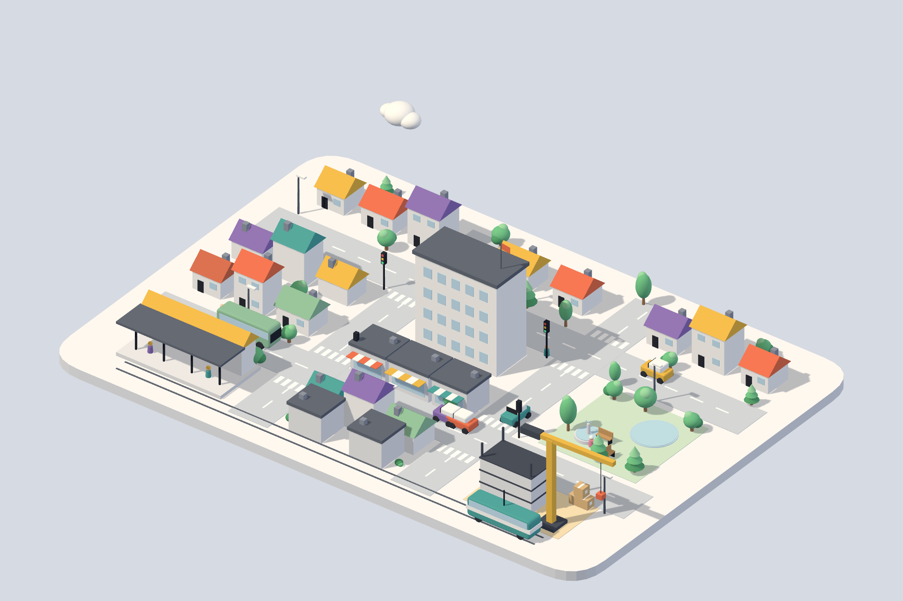
</p>
<p align="center"><sub><code>examples/town.js</code>, a hero. Cars, a bus and a tram keep the streets busy, the crane turns, the fountain splashes, the lights cycle.</sub></p>

---

## Choose your skill

| | Diorama SVG | Diorama Worlds |
|---|---|---|
| Best for | UI, docs, empty states and interactive illustrations | Detailed miniature places with one coordinated story |
| Renderer | Dependency-free SVG | Three.js / WebGL 2 |
| Look | Six tunable themes | Miniature, pixel, halftone, blueprint |
| Examples | 18 SVG figures | 4 original showcase scenes; 3 additional regression subjects |
| Ground | Illustrated rounded base | Flat irregular cutout; slab only when requested |
| Output | One offline HTML, ~30–35 KB gzip | One offline HTML, ~0.77 MB uncompressed |
| Guide | [SVG guide](https://diorama.educalvolopez.com/docs) | [Worlds guide](https://diorama.educalvolopez.com/docs/worlds) |

The file sizes use different measures; they are not a like-for-like benchmark. Install either skill or both. They do not share renderers or dependencies.

<p align="center">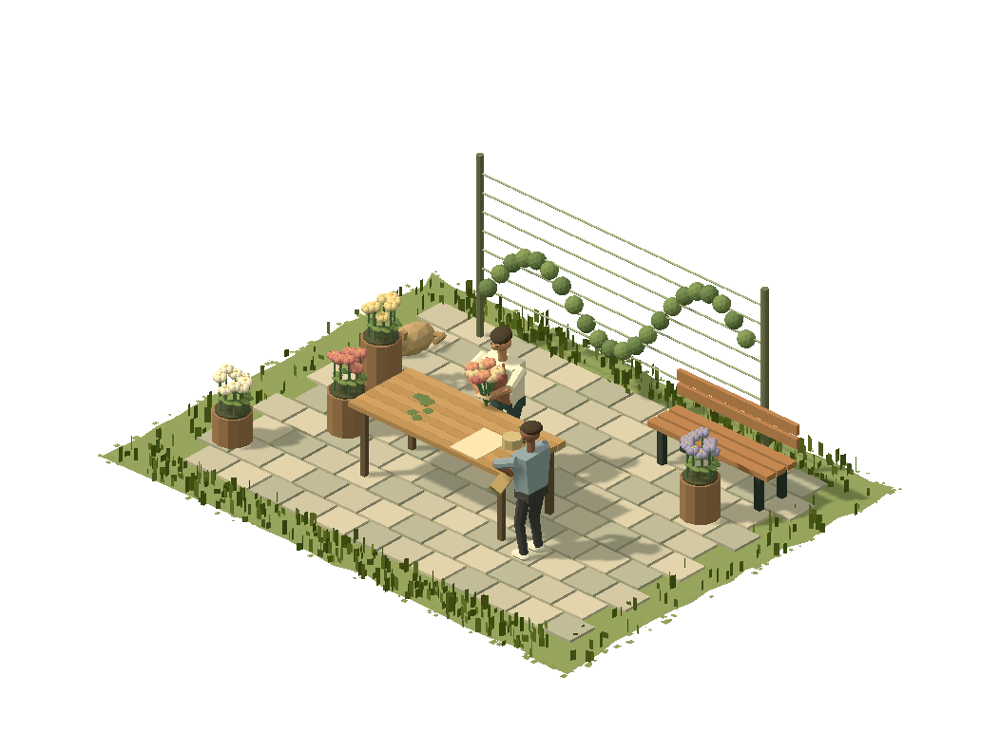</p>

## Quick start

**Diorama SVG** — small illustrations, six themes:

```sh
npx skills add educlopez/diorama --skill diorama -g
```

```text
/diorama a card-sized illustration for the build queue in our docs, mono theme with a teal accent
```

**Diorama Worlds** — detailed miniature stories, four finishes:

```sh
npx skills add educlopez/diorama --skill diorama-worlds -g
```

```text
/diorama-worlds a baker rolling dough beside a brick oven for our landing page. Flat irregular ground, no platform. Halftone finish.
```

In agents without slash commands, ask “Use the diorama skill…” or “Use the diorama-worlds skill…”. Add `-a claude-code` or `-a codex` to target one agent; omit `-g` to install in the current project. Restart/reload the agent if it does not discover the installed skill immediately.

Each skill lives in its own folder under `skills/`. `npx skills add educlopez/diorama` without `--skill` lists them all and lets you pick; `npx skills add educlopez/diorama --list` prints them without installing.

Your agent follows the installed skill’s setup, builds the scene, opens the actual offline output and checks all required views and contacts. For Worlds it first runs `npm ci --ignore-scripts --prefix <installed-worlds-folder>` once. No global build tools or API keys.

## SVG figures

Ask Claude for a 3D illustration and Diorama has it build a place: a yard, a street corner, a rack, a letterbox on a post. Every object is a handful of boxes and cylinders standing on a rounded base, seen from an isometric camera and lit by one warm sun, drawn as SVG the way an illustrator fakes depth: one flat tone per face, the pieces painted from the back to the front, the shadows thrown on the ground as shapes. No three.js, no WebGL, nothing to load. Two or three things keep their own time (a truck on a lap, a forklift shuttle, a flag), one thing answers the pointer, and the camera tilts a few degrees toward the mouse.

The default look is an isometric camera, matte blocks, one warm sun with soft shadows and a few accents, built into a skill with themes, so the same scene file can be a pastel toy town, a cream editorial figure, a monochrome with one accent, a hairline drawing (by hand, if you ask), or a night scene with the lamps on. Every base throws a soft shadow on the page, so the diorama sits on it like a thing on a table. The subject is painted with the accent, so one brand colour recolours it in any theme, and the bench has swatches to try. Things answer a tap as well as the pointer, a thing can come apart under the pointer to show what it is made of, and a read-out under the stage says what the scene is doing, from the same clock that moves it.

<p align="center">
  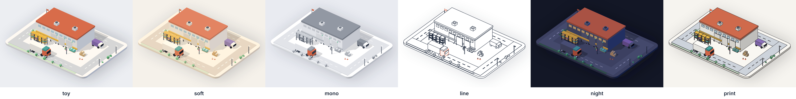
</p>
<p align="center"><sub>One figure file, six themes: <code>toy</code>, <code>soft</code>, <code>mono</code>, <code>line</code>, <code>night</code>, <code>print</code>. The gallery switches them live.</sub></p>

### SVG gallery

| | |
|---|---|
| 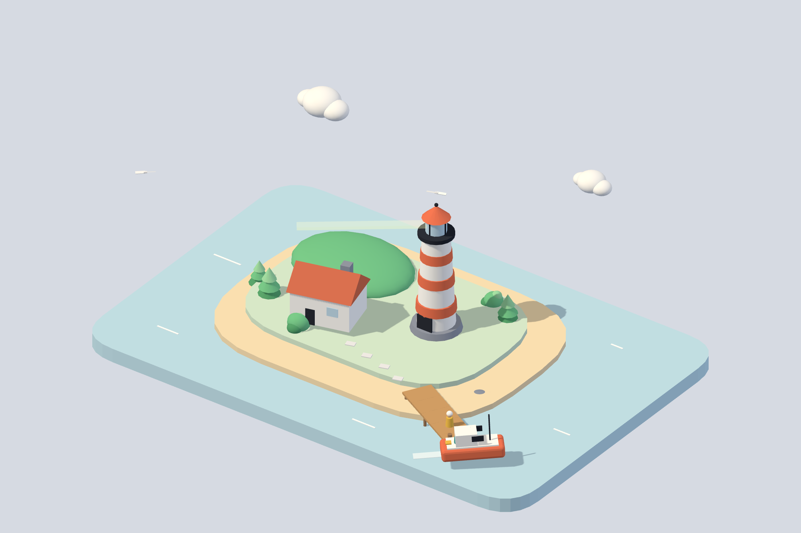 | 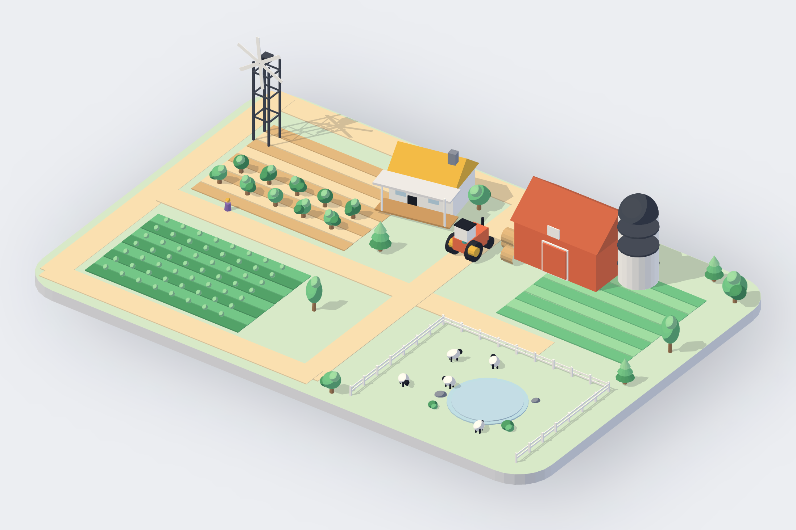 |
| **`island`** · a hero. The boat circles and ties up at the pier, the lamp turns, gulls cross, the waves breathe. | **`farm`** · a hero. The tractor laps the fields and stops at the barn, the windmill turns, the sheep graze. |
| 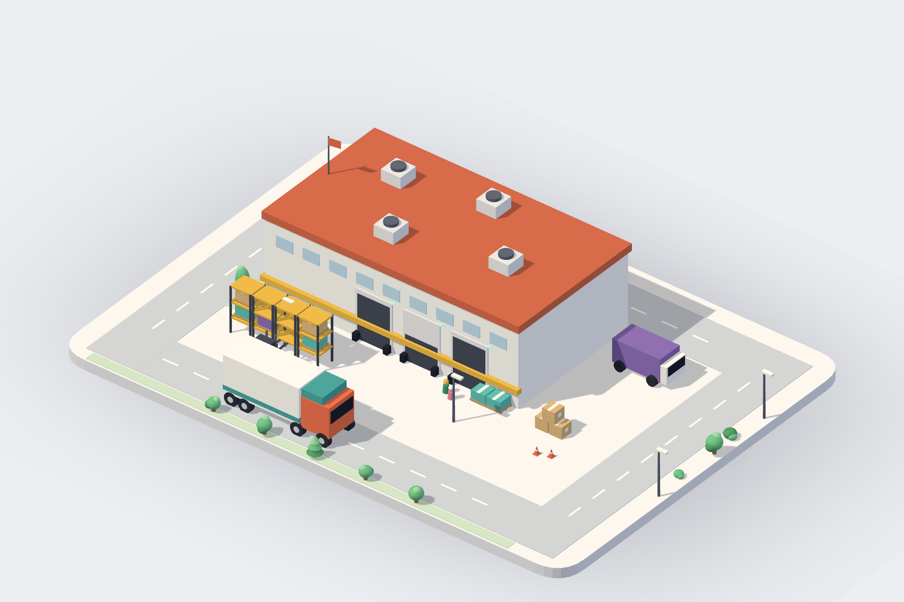 | 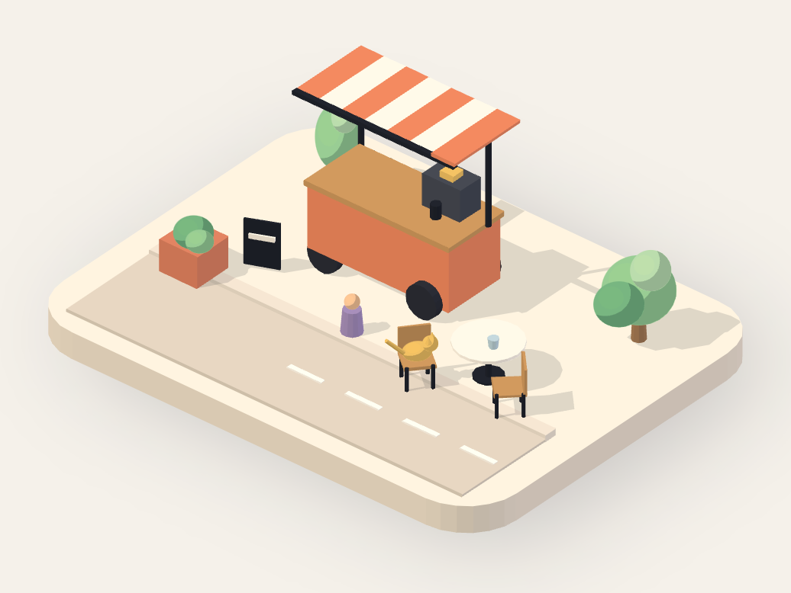 |
| **`warehouse`** · a hero. A truck does a lap and docks, a forklift carries pallets to the racks, a worker walks the aisle. | **`cafe`** · a card in `soft`. The barista pulls shots, a customer comes for a cup, the cat flicks its tail. |
| 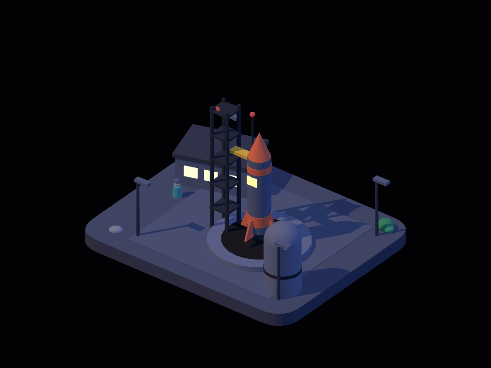 | 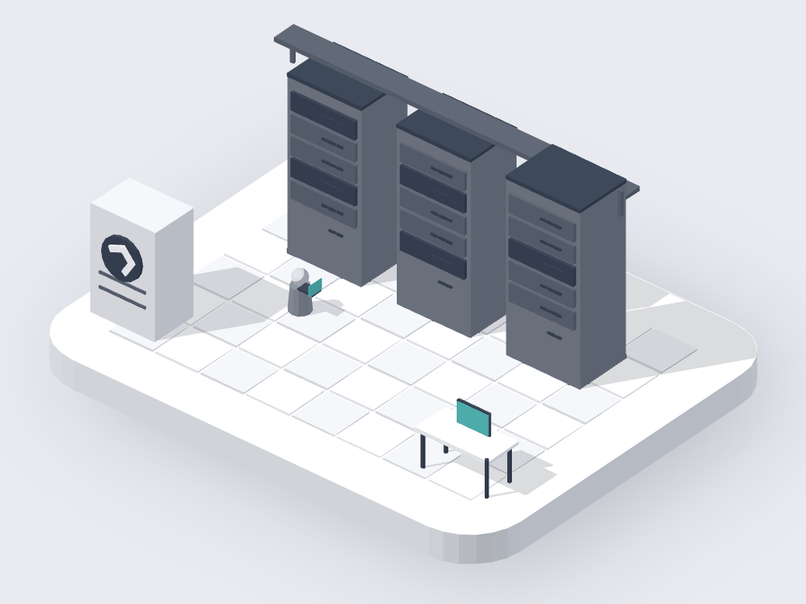 |
| **`launchpad`** · a card, in `night`. The rocket waits under floodlights and every so often the arm swings back and it lifts off. Hover the rocket and it comes apart into its stages; tap the control room and the count reaches zero now. | **`server`** · a card, in `mono` with a teal accent. The racks blink in their own rhythms, the fan turns; hover a rack and all its lights come on. |
| 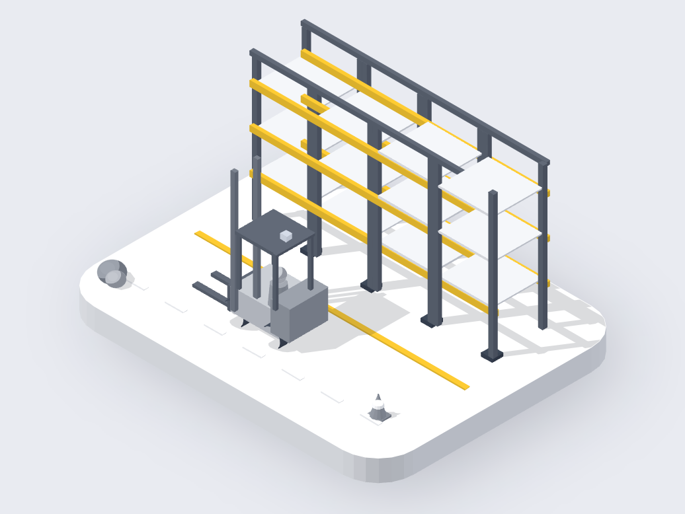 | 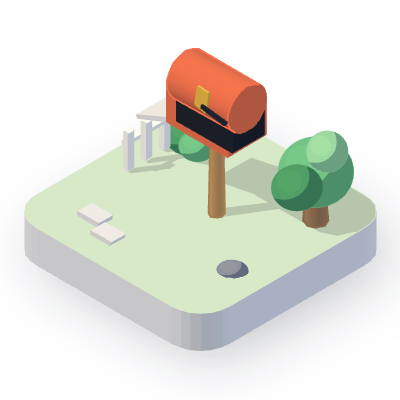 |
| **`rack`** · a card, in `mono` with the beams' yellow as the one accent. Hover a level and the forks go to it. | **`mailbox`** · a mini. The flag lifts every few seconds to check, finds nothing, settles. |
| 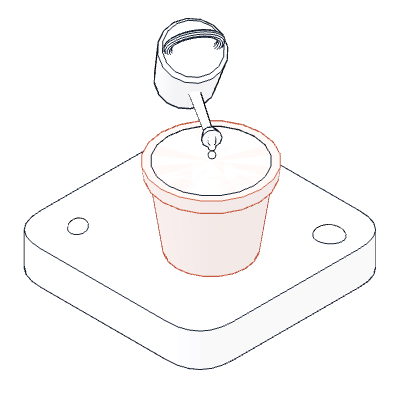 | 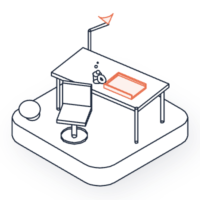 |
| **`seedling`** · a mini, in `line` with the pot as the accent. Now and then the can lifts, turns to the pot and waters the soil. | **`desk`** · a mini, in `line` with a coral accent. The chair swivels, the lamp nods. |
| 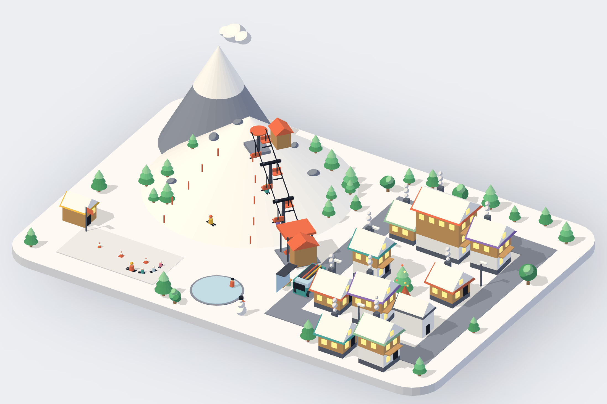 | 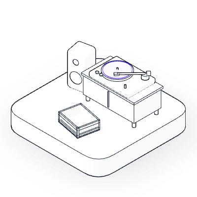 |
| **`powder`** · a hero. Chairs climb the slope, two skiers ride up and carve back down, a ski class snakes the nursery, the shuttle waits at the lift. | **`turntable`** · a mini, in `line` with a purple accent. Now and then the arm swings over, finds no record and goes back. |
| 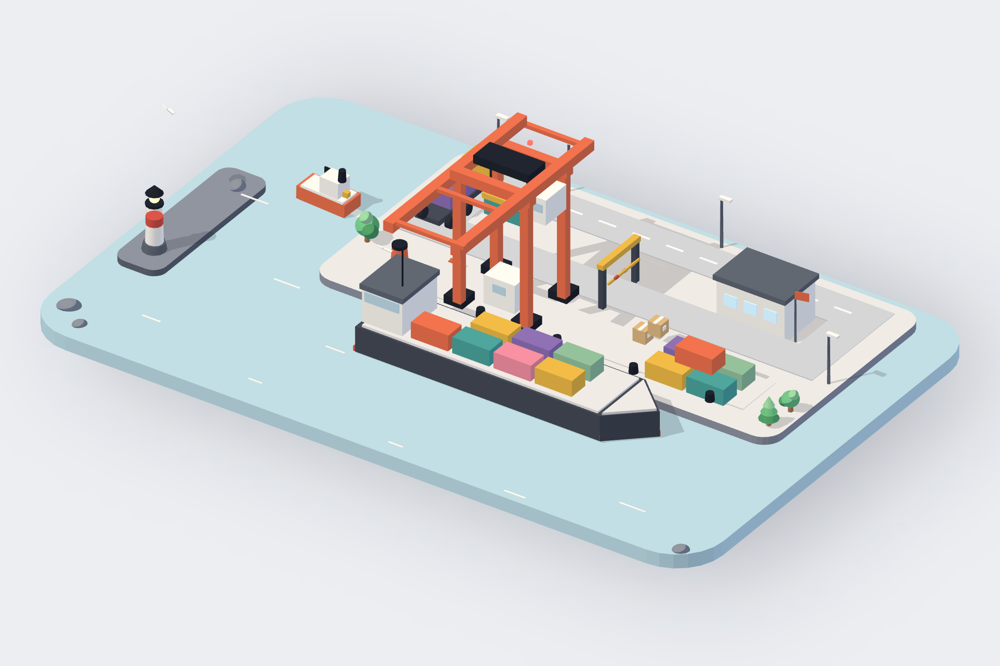 | 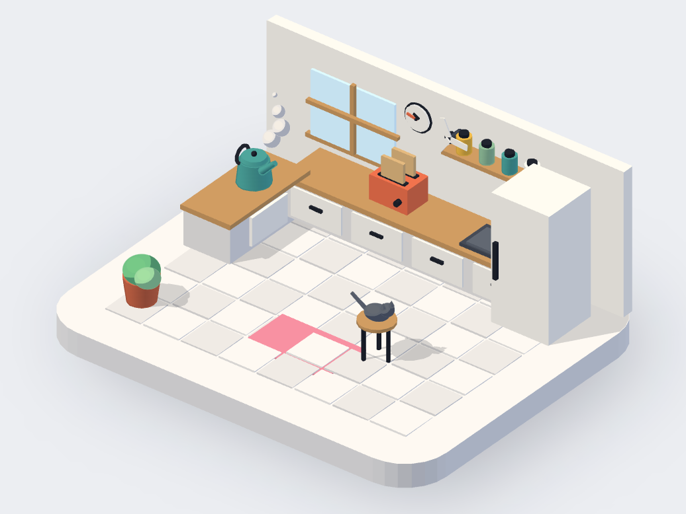 |
| **`harbour`** · a hero. The crane lifts containers off the ship one by one, the tractor laps the quay and waits at the barrier, the tug circles, the lighthouse turns. Tap the crane and the next lift starts now. | **`kitchen`** · a card. The kettle steams, the clock turns, the toast pops now and then. Hover the fridge and the door opens; tap the toaster and it pops now. |
| 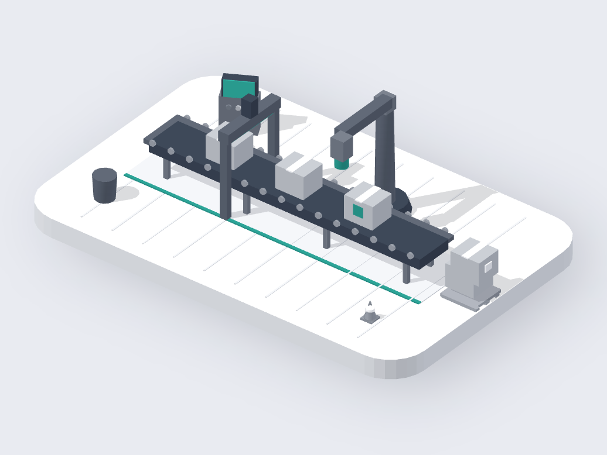 | 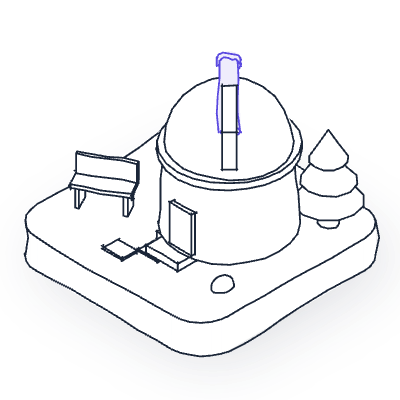 |
| **`assembly`** · a card, in `mono` with a teal accent. Jobs ride the belt through the scanner and under the stamp; tap the gate and the belt holds, the read-out counts what is waiting. | **`observatory`** · a mini, in `line` with a hand-drawn wobble. The dome turns; now and then the telescope lifts, finds nothing yet, and settles. |
| 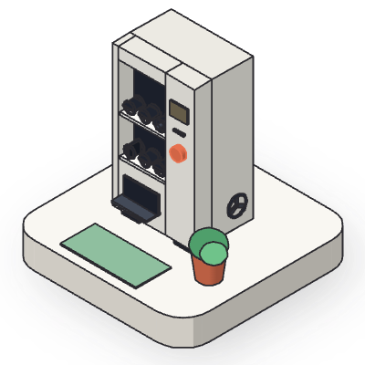 | |
| **`vending`** · a mini, in `print` with an orange button. Every coil is bare; now and then one turns and nothing drops. Tap the button and one turns now. | |

Open them live in the gallery on the site: every figure answers the pointer, names what is under it, switches theme and pauses to its still frame.

## What it makes

Three sizes, one format:

| Size | Where it lives | Stage | What moves |
| --- | --- | --- | --- |
| **hero** | the top of a landing page or README | 3:2, full width | three or four loops with different periods, a pointer answer |
| **card** | beside text in docs or a post | 4:3, ~500px | one process, one pointer answer |
| **mini** | any small spot: an empty state, a feature in a list, a 404 | 1:1, 160–240px | one quiet ambient motion |

### Themes

| Theme | Reads as | Keeps |
| --- | --- | --- |
| `toy` | pastel blocks, one warm sun, a cool fill, soft shadows | every colour |
| `soft` | the same on cream, gentler, desaturated | every colour, shifted warm |
| `mono` | tints of ink on white | one `accent` |
| `line` | a hairline drawing: white fills, ink edges, silhouettes, no shadows | one `accent`, as a stroke |
| `night` | dusk: dark base, cool sky, warm lamps and windows | every colour, darker |
| `print` | flat tones per face and ink lines, no thrown shadows: a printed illustration | every colour |

A theme is a set of fields, and a figure (or a `mount` call) can override any of them:

```js
theme: { base: 'mono', accent: '#5b4ae0', shadows: false, strokeWidth: 1.4 }
// palette, accent, lights, shadows, finish, tone, tint, edges, outline, stroke, strokeWidth, round, glow, halo, wobble
```

`tone` makes any theme monochrome, `edges` and `outline` draw ink on any theme, `round` turns every box into a rounded solid, `lights` replaces any of the four lights, `halo` is the soft shadow the base throws on the page, `wobble` draws the ink by hand (`{ base: 'line', wobble: 1.4 }`), and `accent` is the subject's colour in every theme. The bench page has a theme switcher and accent swatches, and `look.mjs --theme line` writes the sheet for another theme.

Every diorama ships as `diorama-<name>.html`: the kernel, the figure and a small bench page, one file of 30 to 35 KB gzip that draws itself as SVG, crisp at any size, styled by the page's CSS. The figure is a single `Diorama.figure({ … })` call that builds the scene with the toolkit and poses it from the clock, so it drops into React or any page with `Diorama.mount(fig, { el })`.

It honours `prefers-reduced-motion` with one still frame, sleeps when offscreen or in a hidden tab, and never allocates in the loop.

## SVG installation alternatives

With the skills CLI:

```sh
npx skills add educlopez/diorama --skill diorama -g -a claude-code
```

With git:

```sh
git clone https://github.com/educlopez/diorama.git ~/.diorama && mkdir -p ~/.claude/skills && ln -s ~/.diorama/skills/diorama ~/.claude/skills/diorama
```

Without git:

```sh
mkdir -p ~/.claude/skills/diorama && curl -L https://github.com/educlopez/diorama/archive/refs/heads/main.tar.gz | tar -xz --strip-components=3 -C ~/.claude/skills/diorama diorama-main/skills/diorama
```

### Requirements

- Node.js 20 or later, for `build.mjs`, `validate.mjs` and `look.mjs`.
- Chrome or Chromium for the look. `look.mjs` finds Playwright's browser or installs `playwright-core` once into `~/.cache/diorama-look`.
- Nothing at runtime: the page draws SVG, so it needs no renderer, no WebGL and makes no network request. A built page is 30 to 35 KB gzip across the SVG gallery figures.

## Usage

Three habits help:

1. **Say where it will live.** "Hero for the landing page", "card in the docs", "empty state for the inbox". The size sets the budget.
2. **Name the place or the product.** "A harbour", "a kitchen", "our CI service". Claude turns a product into a place.
3. **Give a colour if you have one.** A brand colour goes in as the accent: it recolours the subject in any theme and the rest stays pastel.

Then run the scripts yourself when you want to:

```sh
node ~/.claude/skills/diorama/scripts/build.mjs mailbox.js            # writes diorama-mailbox.html
node ~/.claude/skills/diorama/scripts/validate.mjs diorama-mailbox.html
node ~/.claude/skills/diorama/scripts/look.mjs mailbox.js             # the sheet and the numbers
```

## Examples

- `examples/town.js`: a hero, the big one. Six blocks on two avenues and two streets: houses with gabled roofs, shops with awnings, an office tower, a park with a pond and a fountain, a station with a tram, a building site with a crane; four cars, a bus and a tram on their own laps, walkers, traffic lights, a cloud.
- `examples/island.js`: a hero. A lighthouse island on water: a boat on a lap that ties up at the pier, the lamp turning, gulls, drifting clouds, breathing waves; the pointer lifts the boat, the lighthouse or the house.
- `examples/farm.js`: a hero. Fields, a farmhouse, a barn, a silo, a windmill, a pond with sheep; a tractor on a lap that stops at the barn.
- `examples/warehouse.js`: a hero. A building with docks and a flag, racks, a truck on a lap with a stop, a forklift shuttle with a hand-off, a walker, trees and lamps.
- `examples/cafe.js`: a card in `soft`. A coffee cart with a striped canopy, a barista and steam, a customer who comes for a cup and goes, a cat on a chair.
- `examples/launchpad.js`: a card in `night`. A rocket on its pad under floodlights, a gantry whose arm swings back, a control room; a launch now and then, or now, on a tap; hover the rocket and it comes apart into its stages, and the read-out counts down.
- `examples/server.js`: a card in `mono` with a teal accent. Three racks that blink in their own rhythms, a cooling unit, a technician; hover a rack and its lights all come on.
- `examples/rack.js`: a card in `mono` with one accent. A bare rack, a forklift whose forks rise and settle; hover a level and the forks go there.
- `examples/mailbox.js`: a mini. A letterbox on a post, door open, a fence, a tree and a rock; the flag checks now and then.
- `examples/seedling.js`: a mini in `line`. A pot of soil and a watering can that lifts, turns to the pot and waters it now and then.
- `examples/desk.js`: a mini in `line` with a coral accent. A desk with a lamp, an empty tray and a mug; the chair swivels.
- `examples/powder.js`: a hero. A ski village under a snowy peak: a chairlift on a loop, two skiers who ride up and ski down in turns, a ski class, a shuttle bus, a skater on the pond, smoking chimneys.
- `examples/turntable.js`: a mini in `line` with a purple accent. A record player and an empty crate; the tonearm looks for a record now and then.
- `examples/harbour.js`: a hero. A container quay: a ship with containers on deck, a gantry crane on an 18 s lift cycle, a tractor on a lap that stops at a barrier, a tug in the basin, gulls, a lighthouse on a breakwater; tap the crane and the next lift starts now; the read-out says what the crane is doing.
- `examples/kitchen.js`: a card. A kitchen corner with a wall, a window and a clock, a counter with a sink, a kettle that steams, a toaster that pops, a fridge built as a shell whose door opens under the pointer, a cat on a stool.
- `examples/assembly.js`: a card in `mono` with a teal accent. A belt of jobs through a scanner gate and under a stamping arm; tap the gate and the belt holds; the read-out counts what is waiting.
- `examples/observatory.js`: a mini in `line` with a wobble. A round observatory whose dome turns; the telescope lifts to look now and then.
- `examples/vending.js`: a mini in `print`. A vending machine with bare coils behind an open front, a fan on its side; a coil turns a notch now and then, or now, on a tap.

Build any of them with `node skills/diorama/scripts/build.mjs skills/diorama/examples/<name>.js`.

## Releases

Every version is a tag and a [release on GitHub](https://github.com/educlopez/diorama/releases) with its notes, and [`CHANGELOG.md`](CHANGELOG.md) keeps them all. The releases make themselves: a pull request titled `feat: …` asks for a minor version, `fix: …` for a patch, a `!` after the type for a major; once merged, release-please keeps one pull request open with the changelog and the version bumped, and merging that one creates the tag and the release. Watch the repository for releases to hear about the next one.

## How SVG works

Everything below lives in `skills/diorama/`, the folder the skills CLI installs.

- `SKILL.md` is the skill: size and concept, build, check, hand over, adjust, and the table of what goes wrong.
- `kit/diorama.js` is the kernel, with no dependency: a small scene graph (groups, meshes, materials, vectors and matrices), the orthographic isometric camera fitted to the scene, an SVG painter (one flat tone per face from four lights, a disc and a crescent for a sphere, bands for a cylinder, the pieces sorted back to front, the shadows thrown on the slabs, the halo, the ink with its wobble), the six themes with toning, the primitives (`box`, `rbox`, `cyl`, `cone`, `ball`, `dome`, `wedge`, `slab`, `torus`, `wheel`, `label`), the props (trees, bushes, people, lamps, crates, pallets, cones, flags), the clock helpers (`phase`, `pulse`, `wave`, eases, springs, paths, `apart`), the pointer with picking, the press (`ctx.pressed`, `ctx.active`) and camera tilt, the read-out (`ctx.read`), the halo under the base, the hand-drawn wobble, and the loop that sleeps.
- `bench.html` is the page: a card for every figure, sized to it, with a theme switcher, accent swatches, a still-frame toggle and the live read-out.
- `scripts/build.mjs` assembles the page; `scripts/validate.mjs` runs ten checks (declaration, length, clock, self-containment, kernel, words, colours, base, pointer, drawing); `scripts/look.mjs` takes the sheet of nine pictures in headless Chromium and measures fill, motion, the pointer's answer and a press.
- `references/` hold the long form: concepts, the ten craft rules with the themes and recipes, motion patterns, the look, and embedding in React.
- `apps/site/` is the website (see below).

## Site

`apps/site` is [diorama.educalvolopez.com](https://diorama.educalvolopez.com): the landing, the figures page and the docs, a Next.js app with Tailwind. Its prebuild writes every example into `public/examples` with the skill's own build, so the pages show the real figures live, with a theme switcher on each.

```sh
cd apps/site && npm install && npm run dev
```

To deploy on Vercel, import the repository and set the project's **Root Directory** to `apps/site`; `vercel.json` sets the framework and the defaults do the rest.

## Diorama Worlds

The original `diorama` skill still builds lightweight, dependency-free SVG illustrations. A separate [`diorama-worlds`](skills/diorama-worlds/SKILL.md) skill lives in this same repository for a different purpose: narrative miniature worlds with textured ground, articulated people, fixed orthographic framing and coordinated actions. It owns a Three.js renderer; it does not modify the SVG kernel or its themes.

Four finishes share the same scene: **miniature**, **pixel**, **halftone** and **blueprint**. Halftone adds warm/cool ink dots; blueprint combines blue tonal planes, pale screen-space edges and a faint grid. Both preserve white surroundings using scene depth. Pixel uses a lower-resolution render, nearest-neighbour enlargement, ordered dithering and channel quantization; it is not voxel geometry or hand-authored sprite art. The default showcase uses four original settings: a flower stall, a pottery studio, a morning bakery and a hilltop observatory. Ground defaults to a flat irregular cutout, without a thick platform or soil wall; a raised slab is explicit opt-in. Adult-proportioned characters use planted-foot knee compensation, separate chest/head motion and actual hand/prop anchors. Cricket, basketball and a street juggler remain as regression examples, not the landing’s main content. Worlds is a public first release, not a claim of exact reference fidelity or equal performance on every phone.

```sh
npm ci --ignore-scripts --prefix skills/diorama-worlds
node skills/diorama-worlds/scripts/build-world.mjs skills/diorama-worlds/examples/bakery.js world-bakery.html
node skills/diorama-worlds/scripts/look-world.mjs skills/diorama-worlds/examples/bakery.js work/bakery-look
npm test --prefix skills/diorama-worlds
```

Built Worlds HTML bundles its renderer and needs no network at runtime, but is around 0.76 MB uncompressed, unlike the smaller SVG skill. The look command writes real desktop/mobile screenshots in all four finishes and a JSON report. Open the pictures: runtime checks cannot judge a convincing contact pose or artistic fidelity. The skill has its own dependencies, reference guide and checks under `skills/diorama-worlds/`. The existing website now has a dedicated `/worlds` playground: one live scene at a time, finish and playback controls, a gallery of real rendered posters, local setup instructions and renderer tradeoffs. The home, SVG gallery and SVG docs do not load the Worlds renderer. Site prebuild uses site-owned pinned build dependencies, so a clean site install does not require installing the skill’s own tools first.

## SVG limits

- One scene per page, one `Diorama.figure` call per file. Several dioramas on a page are several mounts.
- No textures, no glass, no particles: the look is matte blocks, shadows and ink lines on purpose.
- A hero of four hundred parts draws in a few milliseconds a frame; what is not moving is not redrawn. Keep heroes under ~400 primitives, and give small cylinders few segments.
- The painter sorts whole pieces by depth, as an illustrator would: a long thin thing beside a small one can be painted in the wrong order for a frame. Split it, or move the small thing.

## Credits

The flat isometric drawing owes a debt to [Anatomy](https://github.com/wheresryan22/anatomy) and [Colorfigures](https://april-zhu.com/colorfigures), two skills that fake 3D in SVG beautifully.

MIT.
